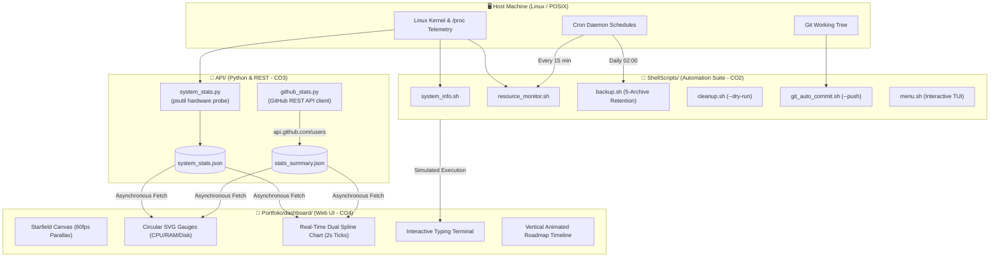

<div align="center">

# ⚡ Developer Productivity &amp; System Monitoring Toolkit
### *A Self-Referential Systems Administration, Automation & Telemetry Suite*

[](https://ubuntu.com)
[](ShellScripts/)
[](API/)
[](Portfolio/dashboard/)
[](LICENSE)

[**Explore Live Dashboard**](https://developer-productivity-toolkit.vercel.app/) • [**System Profile**](Linux/system_profile.md) • [**Automation Suite**](ShellScripts/) • [**REST API**](API/) • [**Learning Roadmap**](Portfolio/roadmap.md)

</div>

---

## 📖 Executive Summary & Project Purpose

The **Developer Productivity & System Monitoring Toolkit** (`DeveloperPortfolio`) is a full-stack engineering capstone project designed to bridge core operating system administration, defensive shell scripting, RESTful telemetry pipelines, and modern glassmorphic web visualization.

Built as a **self-referential developer portfolio**, this repository serves dual purposes:
1. **A Functional System Toolkit:** Actively monitors local compute resources (CPU, RAM, Disk), automates directory backups with strict FIFO retention rotation, purges temporary cache files with non-destructive `--dry-run` safety guards, auto-stages git snapshots, and extracts GitHub API repository statistics.
2. **An Interactive Showcase:** Showcases its own engineering artifacts, system outputs, automation pipelines, and developer credentials through a futuristic 60fps dark "space control room" animated dashboard.

---

## 🏛️ System Architecture & Telemetry Dataflow



---

## 📁 Repository Structure & Course Outcome Mapping

Strictly adhering to academic standards and course outcomes (**CO1 through CO4**), the repository contains zero unauthorized top-level folders:

```
DeveloperPortfolio/
├── Linux/            # Q1 – CO1: Operating system profile, kernel diagnostics & CLI cheat sheet
├── ShellScripts/     # Q2 – CO2: Production Bash automation scripts, rotation & interactive menu
├── API/              # Q3 – CO3: GitHub REST API integration, psutil telemetry & JSON pipelines
├── Portfolio/        # Q4 – CO4: Animated 60fps dashboard, learning roadmap, resume & LinkedIn guide
├── Screenshots/      # Verification evidence matrix mapping screenshots to rubric requirements
└── README.md         # Comprehensive project documentation (Root)
```

### Course Outcome & Question Alignment Matrix

| Directory | Course Question | Course Outcome (CO) | Key Deliverables & Technical Highlights |
| :--- | :---: | :---: | :--- |
| **`Linux/`** | **Q1** | **CO1** | • `system_profile.md`: Full OS, AMD Ryzen 7 CPU, RAM, storage, uptime, user profile.<br>• `command_outputs/`: Saved raw outputs from 11 core commands (`uname`, `lscpu`, `free`, `df`, `top`, `ps`, `uptime`, `whoami`, `ip`, `ls`, `journalctl`).<br>• `commands_cheatsheet.md`: 1-line summary, syntax, flags, and examples. |
| **`ShellScripts/`** | **Q2** | **CO2** | • `system_info.sh`: Formatted hardware & OS report (supports `--json`).<br>• `resource_monitor.sh`: Health watchdog with alerts & `logs/monitor.log`.<br>• `backup.sh`: Timestamped `.tar.gz` with strict 5-archive retention rotation.<br>• `cleanup.sh`: Cache/temp file purge with non-destructive `--dry-run`.<br>• `git_auto_commit.sh`: Automated staging, timestamped commits, and optional `--push`.<br>• `menu.sh`: Interactive ANSI-color TUI launcher uniting all scripts.<br>• `README.md`: Permissions, CLI reference, and crontab scheduling lines. |
| **`API/`** | **Q3** | **CO3** | • `github_stats.py`: Connects to GitHub REST API (`/users` & `/repos`), aggregates total stars, languages, and recent activity with rate-limit handling.<br>• `system_stats.py`: Gathers CPU, RAM, Disk, and Network telemetry via `psutil` with resilient standard-library fallbacks.<br>• `requirements.txt`: Environment dependencies (`requests`, `psutil`).<br>• `github_response.json`, `stats_summary.json`, `system_stats.json`. |
| **`Portfolio/`** | **Q4** | **CO4** | • `dashboard/`: 60fps dark space glassmorphic web UI with canvas starfield, animated SVG gauges, live spline chart, and typing terminal.<br>• `roadmap.md`: Structured multi-phase learning roadmap with milestones.<br>• `resume_template.md`: Professional ATS-friendly engineering resume.<br>• `linkedin_checklist.md`: Headline formulas, About summary, and banner tips.<br>• `github_profile_readme_template.md`: Dynamic shields and stats cards. |
| **`Screenshots/`** | **All** | **CO1–CO4** | • `SCREENSHOTS.md`: Comprehensive proof matrix mapping all 16 screenshot verification points to academic outcomes with reproduction commands. |

---

## 🚀 Key Feature Highlights

### 1. Hardened Bash Automation (CO2)
- **Defensive Error Handling:** Every script initializes with `set -euo pipefail` to prevent silent failures, unbound variable lookups, or masked pipeline errors.
- **Deterministic Paths:** Self-resolving script directory ensures dependable execution regardless of current working directory.
- **Automated Backup Rotation:** `backup.sh` enforces a strict FIFO 5-archive retention policy, preventing disk exhaustion by automatically pruning obsolete archives.
- **Non-Destructive Cleanup:** `cleanup.sh` includes path-safety checks preventing execution against root (`/`), `/home`, or `/etc`, and offers `--dry-run` previews of recoverable bytes.

### 2. Resilient Telemetry & REST API Client (CO3)
- **Zero-Hardcoded Secrets:** Sensitive access tokens are strictly ingested via `os.environ.get("GITHUB_TOKEN")`.
- **Graceful Degradation & Caching:** Both `github_stats.py` and `system_stats.py` gracefully handle network disconnects, DNS timeouts, and sandbox restrictions by falling back to cached datasets without crashing.
- **Standardized Serialization:** Exports clean, frontend-consumable JSON schemas (`stats_summary.json` and `system_stats.json`).

### 3. Space Control Room Glassmorphic Dashboard (CO4)
- **60fps Parallax Particle Canvas:** High-performance HTML5 Canvas rendering ~120 twinkling stars and constellation linkages responding to cursor parallax.
- **3D Hover Tilt & Bobbing Cards:** Cards gently float via CSS keyframes and tilt in 3D space (`perspective: 1000px`) following mouse coordinates.
- **Animated Circular SVG Gauges:** CPU, RAM, and Disk utilization gauges dynamically count up from 0% with smooth cubic-bezier transitions and modulate colors across normal (green), warning (amber), and critical (red) thresholds.
- **Live Spline Chart:** Dual-series dynamic canvas spline chart rendering CPU and RAM histories updating every 2 seconds.
- **Interactive ANSI Terminal Simulator:** Allows users to click script tabs (`backup.sh`, `system_info.sh`, etc.) and watch the simulated command output type out line-by-line with color highlighting.
- **Zero Build Step:** 100% vanilla HTML5, CSS3, and ES6 JavaScript. Deployable immediately to GitHub Pages.

---

## 🛠️ Technology Stack & Dependencies

| Layer | Technologies Used |
| :--- | :--- |
| **Core Operating System** | Linux (Ubuntu 24.04 LTS / Debian 12), POSIX Utilities, Systemd, AMD64 Architecture |
| **Automation & Shell** | GNU Bash 5.2+, `tar`, `gzip`, `awk`, `sed`, `cron` |
| **Backend & APIs** | Python 3.12+, `requests`, `psutil`, GitHub REST API v3, JSON |
| **Frontend UI/UX** | HTML5, CSS3 (Custom Glassmorphism, CSS Grid, Flexbox, Keyframes), Vanilla JavaScript (ES6+) |
| **Typography & Assets** | Google Fonts (*Space Grotesk* for prose, *JetBrains Mono* for telemetry/code), Inline SVGs |
| **Hosting & CI/CD** | Git, GitHub Pages, Local HTTP Server |

---

## ⚡ Installation & Execution Quickstart

### Prerequisites
- Linux or POSIX environment (Native Linux, WSL, macOS, or Git Bash on Windows).
- Python 3.10+ installed.
- Git 2.30+ installed.

### 1. Clone Repository & Setup Permissions
```bash
git clone https://github.com/bajajaarna4-bit/developer-productivity-toolkit.git
cd developer-productivity-toolkit

# Make all shell scripts executable
chmod +x ShellScripts/*.sh
```

### 2. Configure Python Virtual Environment
```bash
# Initialize isolated virtual environment
python3 -m venv .venv

# Activate the environment
# On Linux / macOS:
source .venv/bin/activate
# On Windows PowerShell:
.venv\Scripts\Activate.ps1

# Install dependencies
pip install -r API/requirements.txt
```

---

## 💻 Usage Instructions & Command Examples

### Running the Interactive Automation Menu
Launch the colorful terminal control center:
```bash
./ShellScripts/menu.sh
```

### Individual Script Execution
```bash
# 1. Generate formatted system report (or JSON)
./ShellScripts/system_info.sh
./ShellScripts/system_info.sh --json

# 2. Check CPU/RAM/Disk health against thresholds
./ShellScripts/resource_monitor.sh

# 3. Create compressed tar.gz backup (retaining last 5)
./ShellScripts/backup.sh

# 4. Preview safe cleanup without deleting files
./ShellScripts/cleanup.sh --dry-run

# 5. Perform live workspace cleanup
./ShellScripts/cleanup.sh

# 6. Auto-stage changes and commit with timestamp
./ShellScripts/git_auto_commit.sh -m "feat(api): update telemetry schema"
```

### Running Telemetry & GitHub API Collection
```bash
# Capture live hardware telemetry into API/system_stats.json
python API/system_stats.py

# Query GitHub API and serialize summary into API/stats_summary.json
python API/github_stats.py --username bajajaarna4-bit

# With optional GitHub personal access token for higher rate limits
export GITHUB_TOKEN="ghp_yourTokenHere"
python API/github_stats.py
```

### Launching the Web Dashboard Locally
Because the dashboard loads `stats_summary.json` and `system_stats.json` via asynchronous `fetch()`, serve the directory over HTTP (or open `Portfolio/dashboard/index.html` directly):

```bash
# Launch a lightweight local server from project root
python -m http.server 8080

# Open in browser:
# http://localhost:8080/Portfolio/dashboard/
```

---

## 📸 Verification & Screenshots Guide

Complete visual proof mapping for all rubric requirements is detailed in [**Screenshots/SCREENSHOTS.md**](Screenshots/SCREENSHOTS.md).

| Requirement ID | Verification Scope | Reference Artifact |
| :---: | :--- | :--- |
| **CO1** | Linux System Profile & 11 Command Outputs | [Linux/system_profile.md](Linux/system_profile.md) & [Linux/command_outputs/](Linux/command_outputs/) |
| **CO2** | Bash Automation, 5-Archive Backup & Interactive TUI | [ShellScripts/README.md](ShellScripts/README.md) & [ShellScripts/](ShellScripts/) |
| **CO3** | GitHub REST API, psutil Telemetry & JSON Output | [API/README.md](API/README.md) & [API/stats_summary.json](API/stats_summary.json) |
| **CO4** | 60fps Glassmorphic Dashboard UI & Learning Roadmap | [Portfolio/dashboard/](Portfolio/dashboard/) & [Portfolio/roadmap.md](Portfolio/roadmap.md) |

---

## 🎓 Course Learning Outcomes Demonstrated

- **CO1 (Linux System Fundamentals):** Demonstrated proficiency in inspecting kernel releases, analyzing processor architectures (`lscpu`), evaluating memory pages (`free -h`), auditing systemd service journals, and documenting system profiles.
- **CO2 (Shell Automation & Scheduling):** Demonstrated mastery of defensive Bash scripting (`set -euo pipefail`), automated archive rotation algorithms, path-safe non-destructive cleanup utilities, Git automation, and cron daemon scheduling.
- **CO3 (API Integration & Telemetry):** Implemented client-side RESTful API calls to GitHub with rate-limit headers and token authorization, captured hardware performance counters via `psutil`, and serialized standardized JSON payloads.
- **CO4 (Full-Stack Showcase & Professional Branding):** Designed a high-performance 60fps dark glassmorphic web dashboard, engineered responsive canvas particle systems, formulated an ATS-ready engineering resume, and developed an industry-standard developer roadmap.

---

## 👤 Author & Connect

**Aarna Bajaj**  
*DevOps Engineer & Full-Stack Systems Developer*  
- 🌐 **GitHub:** [@bajajaarna4-bit](https://github.com/bajajaarna4-bit)  
- 💼 **LinkedIn:** [linkedin.com/in/aarna-bajaj](https://linkedin.com/in/aarna-bajaj)  
- 📧 **Email:** [bajajaarna4@gmail.com](mailto:bajajaarna4@gmail.com)  
- 🚀 **Live Dashboard:** [https://developer-productivity-toolkit.vercel.app/](https://developer-productivity-toolkit.vercel.app/)

---

## 📄 License

This project is licensed under the **MIT License** — see the [LICENSE](LICENSE) file for full details.
